<div align="center">

# 🏰 Minecraft Build Studio

### Give your AI agent the skills of a professional Minecraft build team.

Houses with furnished interiors, castles, villages, sculpted landscapes, whole server lobbies and minigame maps.<br/>
Designed in code, **seen** through a real renderer, critiqued, revised, then placed in your world or exported as `.schem`.


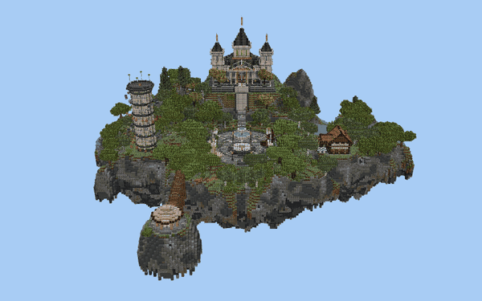

<sub>A complete server lobby: island terrain, symmetric spawn plaza, 4 themed game portals, temple with a furnished hall, parkour tower, shop and satellite island.<br/>Built autonomously by a fresh Claude agent using only this pack, in about 60 tool calls.</sub>

</div>

---

## ⚡ Install: one line for your agent

Paste this into **Claude Code** (or any agent that can run shell commands):

```text
Install Minecraft Build Studio for me by following https://github.com/TheOriUHD/minecraft-build-studio/blob/main/INSTALL.md
```

The agent checks the prerequisites, clones the repo, asks you about the Minecraft EULA, downloads everything into the repo folder (JDK, Paper test server, textures), registers the MCP server and installs the skill plus six build-team agents. Restart Claude Code and ask:

> *Build a medieval cottage with a furnished interior.*<br/>
> *Make a floating-island server lobby with a spawn plaza, four game portals and a temple.*<br/>
> *Build a symmetric 2-team PvP arena in a canyon.*

<details>
<summary><b>Manual install</b></summary>

```bash
git clone https://github.com/TheOriUHD/minecraft-build-studio.git
cd minecraft-build-studio
node scripts/setup.mjs --accept-eula --install-claude   # you accept the Minecraft EULA for the local test server
node scripts/start-server.mjs                           # optional: local Paper server for live placement
```
Requirements: Node.js ≥ 20, Git, Chrome or Edge (for rendering), ~1.5 GB of disk space. Without `--install-claude`, open the repo folder in Claude Code: `.mcp.json` and `.claude/` are picked up automatically. Other MCP clients: see [INSTALL.md](INSTALL.md).
</details>

---

## 🧠 How it works

The agent never places blocks blindly. It works like a studio:

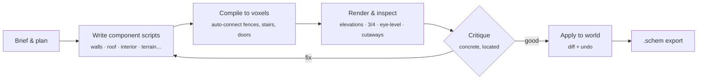

- **Builds are code.** Every project is a folder of small JavaScript components (`foundation`, `walls`, `roof`, `interior`, `terrain`, `vegetation`…) written against a builder toolkit with frames, facades, symmetry, roofs, terrain and furniture. A change like *"make the roof steeper"* is a one-line edit followed by a re-render.
- **The agent can see.** A WebGL renderer with the real vanilla block models and textures produces contact sheets: orthographic elevations with block rulers, 3/4 views, street level, floor plans, sections, dollhouse cutaways, first-person room views and terrain context.
- **It critiques like a professional.** The skill enforces staged work (massing → proportions → structure → depth → interiors → landscape) and a written look–critique–fix loop, backed by a craft handbook with measured lessons from professional server maps.
- **It's a team.** Components can be claimed, there's a task board and a notes board, and subagents act as architect, facade detailer, roofer, interior designer, landscaper and critic.

<table>
<tr>
<td width="50%">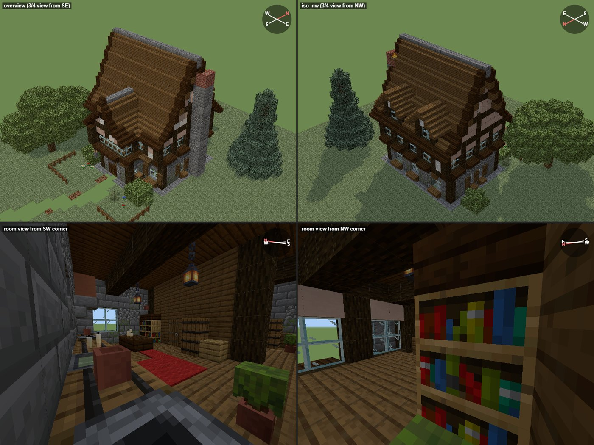<br/><sub><b>What the agent sees</b>: a review sheet with overview, back view and two room views</sub></td>
<td width="50%">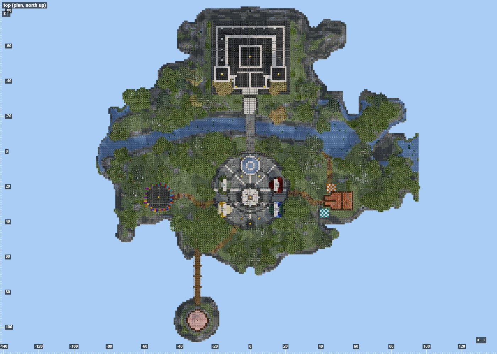<br/><sub><b>Map plan</b> with block rulers, so the agent can turn critique into exact coordinates</sub></td>
</tr>
</table>

---

## 🏡 Buildings with real interiors

<table>
<tr>
<td width="50%">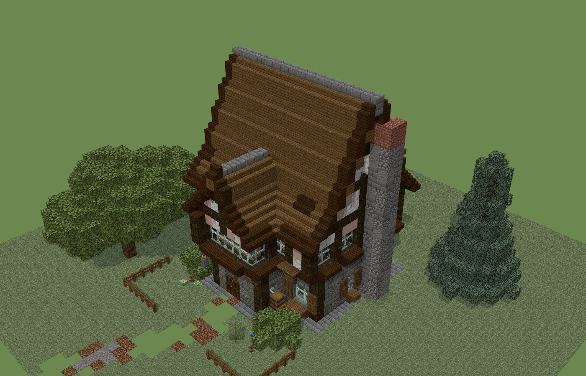</td>
<td width="50%">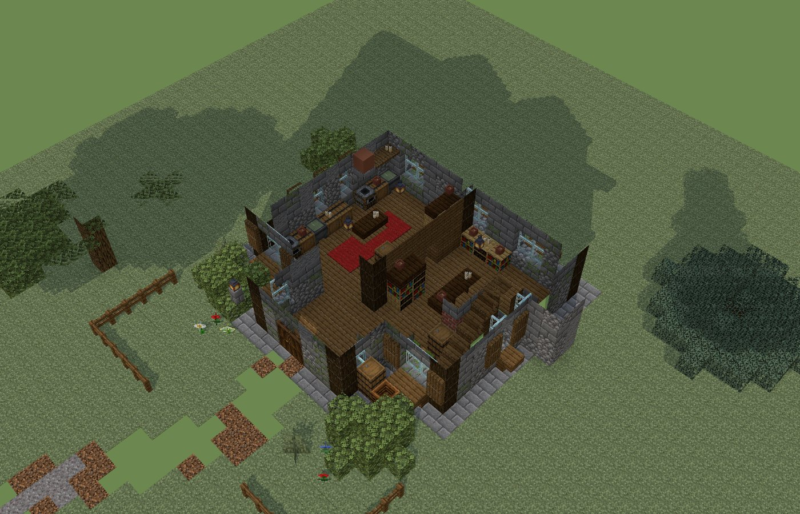</td>
</tr>
<tr>
<td><sub>Timber-framed cottage: stone base with a weathering gradient, jettied upper floor, steep bell-curved roof with contrasting trim and a stone ridge, dormers, chimney with smoke, garden.</sub></td>
<td><sub><code>cutaway_y=3</code>: kitchen, living room with staircase, rugs, tables, shelves, counters and lighting placed by <code>lib.furnish</code>.</sub></td>
</tr>
<tr>
<td>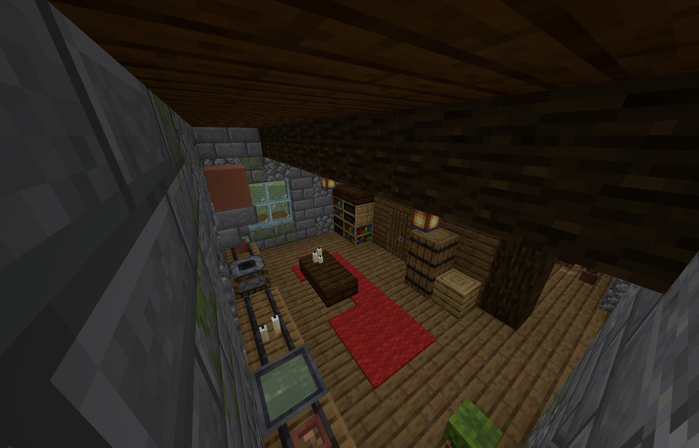</td>
<td>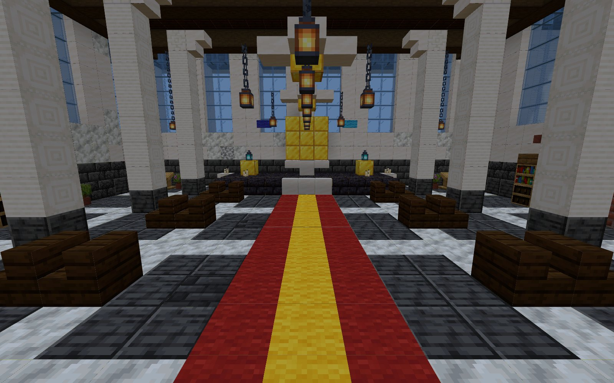</td>
</tr>
<tr>
<td><sub><code>room:</code> view: the kitchen seen from a ceiling corner.</sub></td>
<td><sub>The lobby temple's hall: colonnade, chandeliers, runner carpet, throne dais.</sub></td>
</tr>
</table>

**`lib.furnish(room, {type, style})`** reads the walls, doors and windows of the room, keeps doorways and stairs clear, puts tall furniture against solid walls and low variants under windows, and adds rugs, tables, chandeliers and clutter. There are 10 room types and 8 styles. **`inspect kind:"interior"`** then checks block light and dark spots, headroom, reachability from the door and furniture density.

---

## 🗺️ Landscapes, lobbies and minigame maps

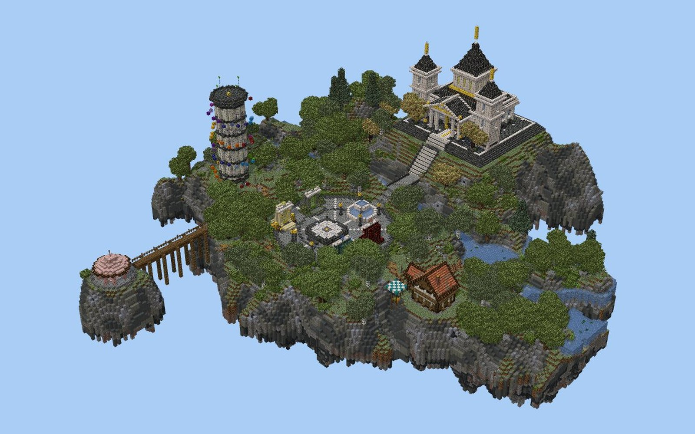

<table>
<tr>
<td width="50%">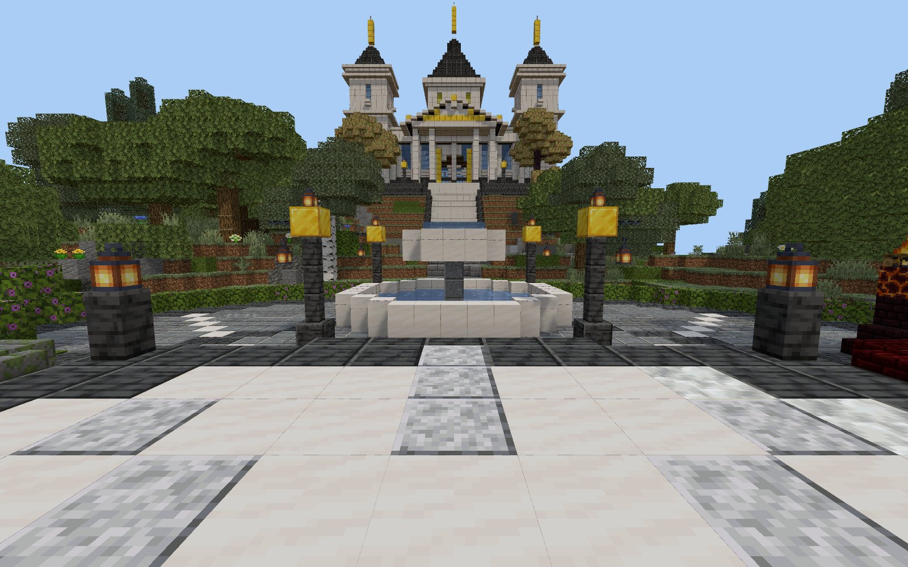<br/><sub>First view from spawn: a symmetric plaza with the fountain on the main axis, framing the temple.</sub></td>
<td width="50%">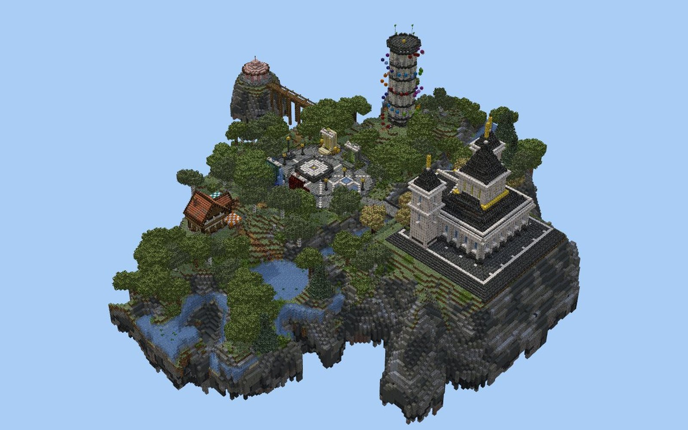<br/><sub>Organic terrain with river, lakes, mixed forests and a tapered floating underside.</sub></td>
</tr>
</table>

- **Terrain sculpting:** `lib.heightmap()` with layered and ridged noise, organic island coastlines, hills, building pads, rivers, terraces, smoothing, and stylised cliff palettes (cyan terracotta/concrete, volcanic, desert, snowy). Floating islands get rocky tapered undersides, and large maps are built as a visible shell so they stay light.
- **Vegetation:** `lib.scatter()` places mixed forests, bushes, rocks, flowers and grass with even spacing. It avoids paths, plazas and cliffs.
- **Symmetry where it belongs:** `b.symmetric`, `b.mirror4`, `b.radial(2|4)` for fair team maps and portal rings, and `b.polar` for rings of lamps or pillars. Spawn cores are symmetric; everything around them stays organic.
- **Lobby pieces:** spawn pads, patterned plazas, fountains, themed game portals, bridges, statues and border walls with towers.

---

## 🎮 Verified in the real game

<table>
<tr>
<td width="50%">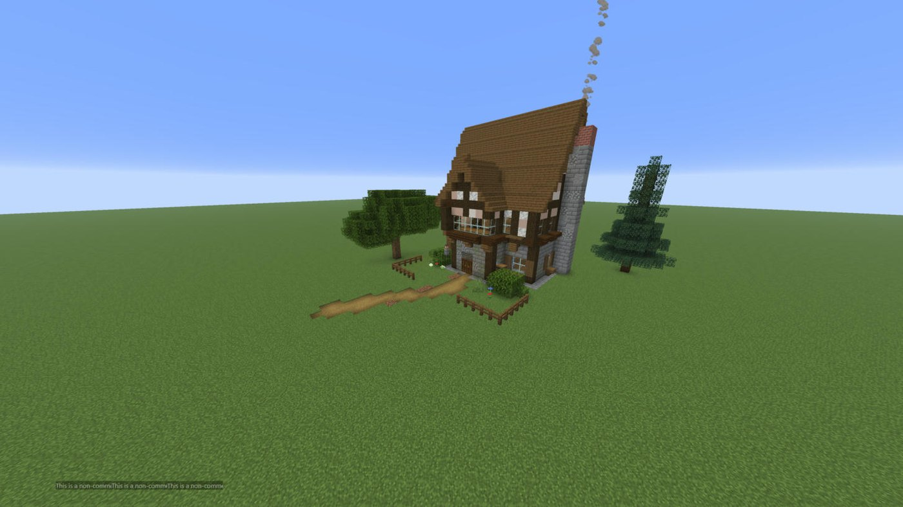</td>
<td width="50%">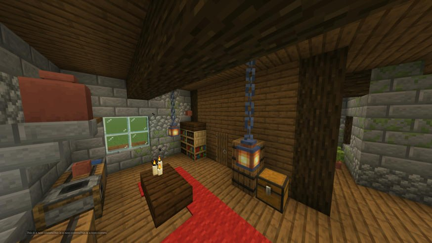</td>
</tr>
</table>

Builds are applied to a local Paper server through a small bridge plugin. Only the changed blocks are written, the original terrain is restored when parts are removed, and every apply creates a checkpoint you can roll back to. Fences, panes, walls and stairs connect correctly, doors get both halves and leaves stay persistent.

---

## 🧰 The toolkit at a glance

```js
// components/walls.js: a facade module designed once, placed on all four sides
const W = 15, D = 11;
b.walls([0, 0, 0], [W-1, 4, D-1], {gradient: ["mossy_cobblestone", "$stone"], axis: "y", from: 0, to: 3});
b.around([0, 0, 0], [W-1, 4, D-1], (f, {side, width}) => {
  for (let x = 2; x < width - 2; x += 3) lib.window(f, x, 1, {sill: "spruce", shutters: "spruce_trapdoor"});
  if (side === "south") lib.door(f, Math.floor(width / 2), 0, {wood: "dark_oak", frame: "spruce_log"});
});
b.roof({a: [0, 0], b: [W-1, D-1], y: 5, type: "gable", pitch: [1, 1, 2, 2], material: "spruce",
        trim: "dark_oak", ridgeTrim: "stone_brick", texture: {material: "dark_oak", amount: 0.15}, gable: "$plaster"});
```

| | |
|---|---|
| **Geometry** | fill, walls, edges, lines, Catmull-Rom curves, circles, cylinders, cones, spheres, ellipsoids, polygon prisms, arches |
| **Frames** | `b.at` (rotate/mirror; block states rotate with the frame), `b.around` facade frames, `b.repeat`, `b.symmetric`, `b.mirror4`, `b.radial`, `b.polar` |
| **Materials** | palettes, weighted and clustered mixes, gradients, checkers, block-state validation with suggestions |
| **Roofs** | gable, hip, shed and flat; multi-part with real valleys; any pitch or pitch profile; overhangs; trims, ridge caps and textures |
| **Details** | windows, doors, columns, timber framing, chimneys, organic trees, bushes, rocks, paths, stairs |
| **Interiors** | `lib.furnish` + individual furniture pieces + `inspect kind:"interior"` |
| **Maps** | heightmaps, islands, pads, rivers, scatter, plazas, spawn pads, fountains, portals, bridges, walls |
| **Views** | `front/back/left/right` (with rulers), `top`, `plan_y=`, `section_x/z=`, `iso_*`, `overview`, `street`, `cutaway_y=`, `room:`, `eye:`, `detail:`, `cam:` |
| **World** | apply as a diff, checkpoints and undo, read back from the world, terrain survey, `.schem` import/export |
| **Study** | `reference`: render, slice and measure the materials of any world save to learn from it |
| **Team** | claims, tasks, notes, MCP role prompts, Claude Code subagents |

<details>
<summary><b>All MCP tools</b></summary>

| tool | purpose |
|---|---|
| `toolkit_reference` | workflow, API, detail library, craft handbook, maps handbook, views |
| `block_search` | exact block ids and properties for this Minecraft version |
| `create_project` · `list_projects` · `project_overview` · `update_project` · `survey_site` | projects, palettes, templates, void/flat worlds, terrain |
| `write_component` · `edit_component` · `read_component` · `write_library` · `component_settings` | build code, ordering, claims |
| `render` | images from the project or the live world, with terrain context; contact sheets or clean presentation shots |
| `inspect` | stats, ASCII slices, block lists, interior analysis |
| `apply` · `checkpoints` · `remove_from_world` | world placement and undo |
| `export_schematic` · `import_schematic` | Sponge `.schem` v3 (WorldEdit/FAWE) |
| `reference` | study any world save |
| `tasks` · `notes` | team coordination |
| `server` | status, start/stop, console commands, teleport a watching player |

Prompts: `master_builder`, `lead_architect`, `facade_detailer`, `roofer`, `interior_designer`, `landscaper`, `critic`.
</details>

---

## 📁 Examples

| example | what it shows | start from it |
|---|---|---|
| [`examples/cottage`](examples/cottage) | staged house build: walls, timber frame, openings, roof with line-work, furnished interior, garden | `create_project {name, template:"cottage"}` |
| [`examples/sky-lobby`](examples/sky-lobby) | whole floating-island lobby: terrain, satellite island, temple + hall, spawn core, 4 portals, paths, shop, parkour, gazebo, vegetation | `create_project {name, template:"sky-lobby", world:"lobby", world_type:"void", site_size:[200,200]}` |

## 🗂️ Repository layout

```
.claude/skills/minecraft-builder/SKILL.md   how the agent builds (workflow, critique loop, interiors, maps, teams)
.claude/agents/                             mc-architect, mc-facade, mc-roofer, mc-interior, mc-landscaper, mc-critic
mcp/                                        MCP server (TypeScript) + knowledge/ (handbooks the agent reads)
plugin/                                     Paper bridge plugin (compiled by setup)
scripts/                                    setup.mjs, start-server.mjs
examples/                                   example projects
docs/images/                                screenshots
runtime/  projects/                         generated locally (not committed)
```

## 🔒 Notes

- The bridge and test server listen on `127.0.0.1` only. Set a `token` in `runtime/server/plugins/BuildMCPBridge/config.yml` and `BUILDMCP_BRIDGE_TOKEN` if others share the machine.
- Component scripts run in a Node `vm` context, which is not a security sandbox. Only open projects you trust.
- Minecraft textures and models are extracted locally from the official client jar and are never redistributed. *Minecraft* is a trademark of Mojang/Microsoft; this project is not affiliated with them.
